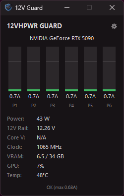
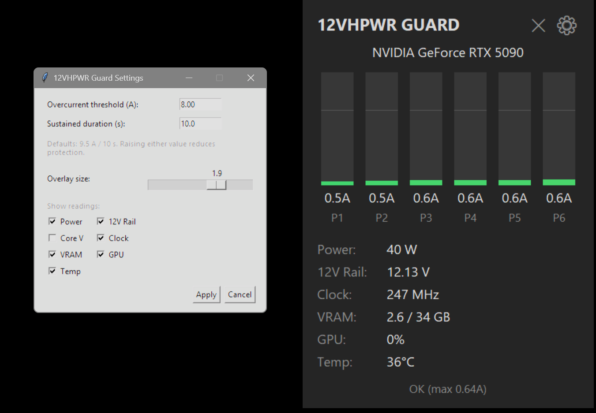

# 12VHPWR Guard + Overlay

A per-pin 12VHPWR current safety monitor and shutdown watchdog for ASUS ROG Astral
RTX 5090/5080 cards, with a lightweight overlay window showing live readings.

  
  

<em>Left: the overlay with every reading shown, running live against a
real ASUS ROG Astral RTX 5090. Right: the settings window (threshold, sustained
duration, overlay size, and which readings are shown).</em>

**[Download the latest Windows installer](https://github.com/ChrisFhey/12vhpwr-guard-with-GUI/releases)** -
see [Installation](#installation).

### About this fork

This is my personal fork of [LunoSama's 12VHPWR Guard](https://github.com/Lunosama/12vhpwr-guard-with-GUI), originally customized for my own setup and shared in case others find it useful.

The project has three layers of authorship:

- **[humza-khalid](https://github.com/humza-khalid)** created the original safety engine,
  [`12vhpwr-guard`](https://github.com/humza-khalid/12vhpwr-guard): per-pin current
  reading, thresholds, GPU mitigation, and emergency shutdown.
- **[LunoSama](https://github.com/Lunosama)** created
  [`12vhpwr-guard-with-GUI`](https://github.com/Lunosama/12vhpwr-guard-with-GUI), which
  added the overlay GUI and the hooks connecting it to the engine. This repository is
  a fork of that project, and all credit for the original application goes to LunoSama.
- **My changes** focus on packaging (a standalone Windows installer with upgrades,
  rollback and migration from the script install), usability (a native window, the
  project icon), and a few additional improvements such as reconnecting GPU telemetry
  after driver hiccups.

## What this is

This project has two parts:

- **`guard/`** - the safety-critical monitoring engine. This is a vendored copy of
  [`humza-khalid/12vhpwr-guard`](https://github.com/humza-khalid/12vhpwr-guard) v1.3.1
  (MIT license, see `guard/LICENSE`), with additive extensions (`telemetry.py`,
  `status_writer.py`, `settings_bridge.py`, `hwinfo_voltage.py`, `app_paths.py`, and
  hook points in `hwinfo_12vhpwr_guard.py`) to export live GPU telemetry, accept
  settings changes from the overlay, and store data under ProgramData when installed.
  What that means for the protection logic:
  - The I2C sensor code (`astral_i2c.py`) is identical to upstream 1.3.1, and the GPU
    mitigation code (`gpu_mitigation.py`) differs only in where it stores its
    crash-recovery marker file.
  - In `hwinfo_12vhpwr_guard.py` the threshold comparison, tiered response, and
    shutdown code are unchanged, but the monitor loop around them has hooks: each tick
    it may apply a threshold/sustained-time change requested by the overlay (through
    the same setters the tray menu uses) before reading the thresholds, and it writes
    a status snapshot, including just before a shutdown.
  - The default sustained window is **10 s instead of upstream's 15 s** (stricter).
  - Newer upstream releases (1.3.2 and later) are not merged into this repository.
- **`overlay/`** - an unprivileged window showing color-coded bars for all 6 pins plus
  GPU power/voltage/clock/VRAM/usage/temperature/name, and a settings popup to edit
  the threshold, sustained time, overlay size, and which readings are shown. It is a
  normal native Windows window - title bar, taskbar entry, fixed size, slightly
  translucent, dark title bar where supported - and is **not** always-on-top, so other
  windows can cover it. It remembers its position, size, and visible readings. Only the
  settings popup stays on top while it's open.

**Full credit for the safety engine belongs to [humza-khalid](https://github.com/humza-khalid)
and the upstream project's contributors** - the I2C protocol reverse-engineering, the
tiered response ladder, reversible GPU mitigation via NVML, crash recovery, and
flight-recorder logging are entirely their work. Neither LunoSama's project nor this
fork wrote, or claims credit for, any of it. `guard/README.md` is their original
documentation, vendored here verbatim so it travels with the code (it describes
upstream's own install scripts and defaults); `guard/LICENSE` is their original MIT
license text. See `LICENSE` at the project root for the terms the `overlay/` GUI, the
additions in `guard/`, and the installer are distributed under.

## Hardware support

Same as upstream: **ASUS ROG Astral RTX 5090 / 5080 cards only**. These are the only
consumer cards known to expose per-pin 12VHPWR current via an onboard ITE IT8915FN
chip. See `guard/hwinfo_12vhpwr_guard.py`'s `ASTRAL_SUBSYSTEM_IDS` for the exact
supported PCI subsystem IDs.

## Architecture

Two separate OS processes:

1. **Guard** (`guard/hwinfo_12vhpwr_guard.py`, `12VHPWR-Guard.exe` when installed) -
   runs elevated via Task Scheduler (registered by the installer, or by
   `guard/install.ps1`). Reads per-pin current directly from the card,
   decides thresholds, mitigates or shuts down, and writes a `status.json` snapshot
   to the project root (`C:\ProgramData\12VHPWR Guard` when installed with the setup
   program) every ~0.5s for the overlay to read.
2. **Overlay** (`overlay/overlay_app.py`, `12VHPWR-Guard-Overlay.exe` when installed) -
   runs unprivileged, autostarts via a Startup-folder shortcut (created by the
   installer, or by `overlay/install_overlay_autostart.ps1`).
   Polls `status.json`, never touches the GPU or any hardware API directly. Settings
   changes are requested via a small `pending_settings.json` file that the guard
   validates and applies through the same setters the tray menu uses (the overlay
   shows its own "reduced protection" confirmation before sending a weaker value).

Neither process needs the other to be installed to build/run, but the overlay shows
"Disconnected" and no live data unless the guard is running and writing `status.json`.

Core voltage (~0.8V) is sourced from HWiNFO's shared memory (`hwinfo_voltage.py`) if
HWiNFO is running with Shared Memory Support enabled - it's optional and shows N/A
otherwise, with zero impact on the rest of the guard. See
[Core voltage requires HWiNFO](#core-voltage-requires-hwinfo---unlike-every-other-reading)
below for what makes this one reading different from everything else, and how to
turn it on.

## Installation

### Recommended: Windows installer

You need 64-bit Windows 10 or 11, an administrator account, and a supported card
(see [Hardware support](#hardware-support)). **Python is not required.**

> **Keep the GPU idle while installing or upgrading.** Setup stops the running
> watchdog for a short time before starting the new one, and the card isn't protected
> in between. Close games and other GPU-heavy apps first.

1. Open the [Releases page](https://github.com/ChrisFhey/12vhpwr-guard-with-GUI/releases)
   and, under **Assets** of the latest release, download **`12VHPWR-Guard-Setup-*.exe`**
   (`*` is the version number).
2. Run it and approve the administrator (UAC) prompt. The installer isn't code-signed,
   so Windows SmartScreen may show "Windows protected your PC". Only continue if you
   downloaded the file yourself from the Releases page above
   (`github.com/ChrisFhey/12vhpwr-guard-with-GUI`); if it came from anywhere else, delete
   it. If the release notes list a SHA256 checksum, you can compare it first with
   `Get-FileHash .\12VHPWR-Guard-Setup-*.exe` in PowerShell. Then choose
   **More info → Run anyway**.
3. Follow the installer. Leave **"Start the overlay automatically at logon"** ticked
   unless you don't want the overlay window.
4. On the last page, leave **"Start the overlay now"** ticked and click **Finish**.

The installer sets everything up for you:

- **The guard (watchdog)** is registered as an elevated Task Scheduler task that
  starts at every logon, and it is started straight away. Look for its tray icon.
- **The overlay** starts automatically at logon, without administrator rights. If you
  close it, reopen it from the Start Menu: **12VHPWR Guard Overlay**.
- Program files go to `C:\Program Files\12VHPWR Guard`; settings and logs are kept in
  `C:\ProgramData\12VHPWR Guard`.

**Afterwards, check that protection is live:** the guard's tray icon is present, and the
overlay shows changing per-pin readings for all six pins rather than "Disconnected".
Do the same after every upgrade.

### Upgrading

Download the newer `12VHPWR-Guard-Setup-*.exe` from the Releases page and run
it over the existing installation (re-running the same version also works), with the
GPU idle as described above. Your settings and logs are kept. The installer stops the
guard, replaces the program files, starts the new guard, and checks that exactly one
instance keeps running.

If that fails, setup **tries** to recover: it restores the previous program files and
scheduled task and restarts the previous guard, and shows an error if that recovery
didn't work either. Recovery isn't guaranteed, so always check that protection is live
afterwards; the details are logged in `C:\ProgramData\12VHPWR Guard\setup.log`.

**Coming from the script install below?** The installer detects it, takes over its
settings, stops the old guard, and removes the old overlay's autostart shortcuts. Your
old project folder is left as it is - just don't run its `install.bat` or
`uninstall.bat` afterwards, as they manage the same scheduled task.

### Uninstalling

Open **Settings → Apps → Installed apps**, find **12VHPWR Guard**, and choose
**Uninstall**. This stops the guard and overlay and removes the scheduled task,
shortcuts and program files. You'll be asked whether to also delete your settings and
logs; the default is to keep them, so a later reinstall picks them up again. If the
guard was limiting the GPU when it was stopped, restart Windows to restore normal
clocks.

Building the installer yourself is covered in [`installer/README.md`](installer/README.md).

### Alternative: script installation (requires Python)

These options run directly from a copy of this repository and need Python 3.10+
installed and on `PATH`. Use them only instead of the Windows installer, not alongside it.

#### Option A: combined script installer

Double-click **`install.bat`** at the project root and approve the single UAC prompt.
This installs both pieces in one run:

1. Runs the guard's setup (creates the Python virtual environment, installs
   dependencies, registers the Task Scheduler entry, registers the Event Log source)
   - identical to running `guard\install.bat` directly.
2. Creates the overlay's three shortcuts (Startup folder, Start Menu, and one in
   `overlay\` itself) so it autostarts at every future logon - identical to running
   `overlay\overlay_installer.bat` directly.
3. Asks **"Start 12VHPWR Guard now? (y/N)"** and then **"Start the overlay now?
   (y/N)"**. Say yes to either and it starts immediately. The overlay is launched via
   a brief, self-deleting, non-elevated Task Scheduler task so it never inherits the
   installer's admin rights (verified: a process spawned directly from an elevated
   script would otherwise inherit that elevation, which the overlay must never have).

To remove both pieces the same way, double-click **`uninstall.bat`** at the project
root and approve the UAC prompt - it removes the guard's Task Scheduler entry and
Event Log source, then all three overlay shortcuts and stops any running instance,
and reports exactly what it verified was actually removed (not just what it attempted).

#### Option B: install guard and overlay separately

Useful if you only want one piece, or want to reinstall/upgrade just one of them.

1. Install the guard - double-click `guard\install.bat` and approve the UAC prompt
   (it needs administrator rights to register the Task Scheduler entry and lock GPU
   clocks/power limit during mitigation). This creates a Python virtual environment,
   installs dependencies, and starts the guard running in the background.

2. Install the overlay - double-click `overlay\overlay_installer.bat` **without**
   running it as administrator (the overlay must never run elevated). This adds a
   Startup-folder shortcut (launches automatically at every future logon), a Start
   Menu shortcut, and a shortcut right in the `overlay\` folder itself, and starts
   it immediately so you don't have to log off/on to see it. If you ever close the
   overlay's window (the ✕ button fully exits it, by design), reopen it with any of
   those three shortcuts - Start Menu search is the most convenient.

To remove either piece later: `guard\uninstall.bat` (elevated) for the guard,
`overlay\overlay_uninstaller.bat` (normal, non-elevated) for the overlay. Each
uninstaller only touches its own piece - uninstalling the overlay leaves the guard's
protection running, and vice versa.

Both options produce the same end result. `install.bat`/`uninstall.bat` at the
project root call `guard\install.ps1`/`guard\uninstall.ps1` directly, then handle
the overlay's shortcuts inline using the same logic as
`overlay\install_overlay_autostart.ps1`/`overlay\uninstall_overlay.ps1` (rather than
calling those scripts, since the overlay installer deliberately refuses to run
under an elevated session - see the note above about the overlay never inheriting
admin rights). Uninstalling does call `overlay\uninstall_overlay.ps1` directly,
since removing files/stopping a process isn't privilege-sensitive the way launching
one is.

**Note:** `Unregister-ScheduledTask` silently fails with "Access is denied" if not
run elevated - always launch installers/uninstallers via their `.bat` file (not the
`.ps1` directly) so the UAC prompt fires, and if in doubt, verify the Task Scheduler
entry is actually gone yourself (`Get-ScheduledTask -TaskName "12VHPWR Guard"` should
return nothing) rather than trusting a script's printed message alone.

## Configuration

Threshold (`threshold_amps`, default 9.5 A) and sustained duration
(`sustained_seconds_required`, default **10 s** in this fork - upstream ships 15 s) can
be changed from either the guard's tray icon menu or the overlay's settings popup
(gear icon). Both apply live, with no restart required, and both warn before accepting
a value weaker than the default. They are stored in `C:\ProgramData\12VHPWR Guard\config.ini`
with the Windows installer, or `guard\config.ini` with the script install.

For the full detail on severity tiers, mitigation behavior, and HWiNFO fallback
configuration - whose logic comes unchanged from upstream - see `guard/README.md`, the
original upstream documentation vendored verbatim in this repo, or the
[upstream project itself](https://github.com/humza-khalid/12vhpwr-guard).

### Core voltage requires HWiNFO - unlike every other reading

Every other overlay reading (per-pin current/voltage, power, clock, VRAM, GPU usage,
temperature, GPU name) comes straight from the card's own I2C chip or NVIDIA's NVML -
**no third-party tool needed for any of them.** Core voltage (~0.8V, the GPU die's
own operating voltage) is the one exception: NVIDIA has no public API for it at all
(confirmed against NVML's own documentation and NVIDIA's developer forum), so this
project deliberately does not implement it via an undocumented/reverse-engineered
driver call - see `guard/hwinfo_voltage.py`'s docstring for why. Instead it reads the
value HWiNFO already computes correctly, over the same shared-memory mechanism the
guard already uses as its optional current-reading fallback.

**Without HWiNFO running, the overlay's "Core V" field simply shows `N/A` - nothing
else is affected.** To enable it:

1. Install and run [HWiNFO](https://www.hwinfo.com/) (the free "Sensors-only" mode
   is enough - the full system summary window is not required).
2. In HWiNFO's Sensors window, right-click anywhere → enable **"Shared Memory
   Support"** (this may also be under HWiNFO's main Settings dialog depending on
   version - look for "Shared Memory Support" specifically, not just having the
   Sensors window open).
3. That's it - no restart needed. The guard checks for it automatically every 30
   seconds and picks it up as soon as it's available; you'll see the overlay's
   "Core V" field populate with a real value (matching what HWiNFO itself reports
   as "GPU Core Voltage") within that window.

If HWiNFO is closed or Shared Memory Support gets turned off later, the field just
reverts to `N/A` - the guard's own protection logic never depends on this value at
all, so there's no risk in leaving it disabled.

## Resource usage

> **Historical measurements.** The figures in this section and the game benchmark
> below were recorded with the earlier script-based version (Python + `pythonw.exe`).
> They have not been re-measured for the PyInstaller executables used by the Windows
> installer, whose memory use and startup in particular may differ.

Measured on a 24-logical-core system (Ryzen 9 7900) with an RTX 5090, both processes
running simultaneously and actively polling/writing at their normal ~0.5s (guard) and
~0.2s (overlay) intervals:

| | Guard | Overlay |
|---|---|---|
| CPU | ~1.4% of one core | ~1.25% of one core |
| Working set (RAM) | ~42 MB | ~32 MB |
| Threads | 5 | 2 |

Combined, that's under 3% of a single core and roughly 75 MB of RAM - on a 24-core
machine, effectively immeasurable against total system capacity. Neither process
showed any memory growth over multiple hours of continuous operation across several
test sessions (working set stayed flat, no leak).

### In-game overlay impact test

Tested with the overlay running throughout a **Black Myth: Wukong** benchmark run
(RTX 5090, driver 616.56), compared against an identical run with the overlay fully
uninstalled:

| | Overlay ON | Overlay OFF |
|---|---|---|
| Average FPS | 43 | 43 |
| Max FPS | 53 | 52 |
| Min FPS | 24 | 36 |
| Low 5th percentile | 38 | 38 |
| VRAM used | 12.4 GB | 12.8 GB |

Average and Low 5th percentile - the numbers that actually reflect sustained
performance - were identical between runs. The overlay's CPU/memory footprint stayed
flat and unremarkable throughout both benchmark passes (sampled continuously during
the run). The one-off Min FPS difference does not correlate with any measurable
resource spike from the overlay and is consistent with normal single-frame benchmark
noise (a background hitch, shader compile, or similar), not a sustained effect - it
did not appear in the Low 5th percentile, which would have been affected by any real,
repeated overlay interference.

Because the overlay is a plain desktop window (no DLL injection, no
render-thread hooking, unlike RTSS/Discord-style in-game overlays), this result lines
up with what its architecture predicts: it draws to its own separate window and never
touches the game process at all.

## Safety notice

This is a supplementary safety measure only and does not guarantee protection against
connector overheating, melting, or damage. Do not raise the threshold or sustained
duration above the defaults unless you understand and accept the increased risk.
